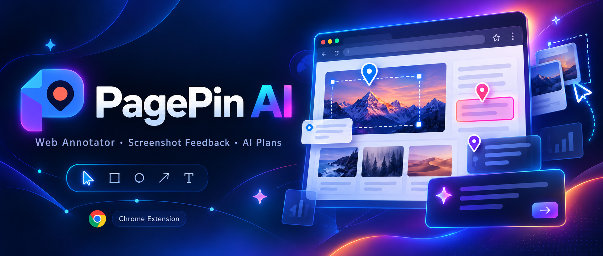

<p align="center">
  
</p>

<p align="center">
  <strong>Capture visual feedback. Attach evidence. Ship better UI.</strong><br />
  Chrome Extension local-first untuk anotasi visual, screenshot-aware feedback, export Markdown, dan implementation plan dengan AI.
</p>

<p align="center">
  
  
  
</p>

| Informasi          | Nilai                                       |
| ------------------ | ------------------------------------------- |
| **Versi**          | `0.6.25`                                    |
| **Manifest**       | Chrome Manifest V3                          |
| **Minimum Chrome** | `114+`                                      |
| **Storage**        | IndexedDB lokal + Chrome Storage            |
| **Privasi**        | Local-first, tanpa akun dan tracking bawaan |
| **Lisensi**        | [MIT](LICENSE)                              |

---

## Daftar Isi

1. [Tentang Project](#tentang-project)
2. [Fitur Utama](#fitur-utama)
3. [Persyaratan](#persyaratan)
4. [Instalasi](#instalasi)
5. [Quick Start](#quick-start)
6. [Workflow Annotate](#workflow-annotate)
7. [Scope Annotation](#scope-annotation)
8. [Screenshot dan Clipboard](#screenshot-dan-clipboard)
9. [Export Markdown](#export-markdown)
10. [Generate Plan dengan AI](#generate-plan-dengan-ai)
11. [Konfigurasi AI Provider](#konfigurasi-ai-provider)
12. [Console Capture](#console-capture)
13. [Keyboard Shortcuts](#keyboard-shortcuts)
14. [Contoh Penggunaan](#contoh-penggunaan)
15. [Troubleshooting](#troubleshooting)
16. [Privasi dan Keamanan](#privasi-dan-keamanan)
17. [Lisensi](#lisensi)

---

## Tentang Project

PagePin AI membantu tim **product**, **design**, **QA**, dan **development** mengubah feedback visual di halaman web menjadi data yang terstruktur dan siap ditindaklanjuti.

Dengan PagePin AI, pengguna dapat:

- memilih elemen HTML langsung dari halaman;
- memberikan komentar pada lokasi UI tertentu;
- menyimpan selector, text, bounding box, dan metadata elemen;
- mengambil screenshot target;
- mengelompokkan anotasi berdasarkan page, URL, domain, atau semua halaman;
- menyalin atau mengunduh laporan Markdown;
- membuat implementation plan dengan provider AI pilihan pengguna.

PagePin AI **tidak mengubah source code website target**. Extension hanya membaca konteks elemen yang dipilih, menyimpan feedback lokal, dan menyediakan export.

### Prinsip desain

1. **Local-first** — data anotasi dan screenshot disimpan di perangkat pengguna.
2. **Portable** — output Markdown dapat dipakai di issue tracker, editor, repository, atau AI coding agent.
3. **Evidence-based** — feedback menyertakan selector, lokasi, metadata, dan screenshot.
4. **Provider-agnostic** — mendukung provider lokal dan endpoint OpenAI-compatible.
5. **Recoverable** — relasi annotation/screenshot dan state provider memiliki mekanisme recovery.

---

## Fitur Utama

### 1. Visual annotation

- Pick elemen langsung dari halaman.
- Modal annotation yang dapat digeser dan memiliki scroll internal.
- Komentar, intent, severity, dan status.
- CSS selector, XPath, test ID, role, stable ID.
- Element HTML dan text snapshot yang disanitasi.
- Bounding box, viewport, dan styles penting.
- Retarget untuk elemen yang berubah.
- Marker bernomor pada halaman.

### 2. Screenshot

- Screenshot elemen atau halaman saat annotation dibuat.
- Metadata viewport, ukuran gambar, dan device pixel ratio.
- Penyimpanan lokal dengan path `PagePin/YYYY-MM-DD/`.
- Link file dan preview Markdown.
- Copy satu atau banyak image melalui rich clipboard.
- Repair otomatis untuk relasi screenshot yang tidak lengkap.

### 3. Multi-scope annotation

| Scope                        | Cakupan                                     |
| ---------------------------- | ------------------------------------------- |
| **This page**                | Origin + pathname halaman aktif, tanpa hash |
| **This URL / origin**        | Semua halaman pada origin yang sama         |
| **This domain + subdomains** | Registrable domain dan subdomain yang cocok |
| **All pages**                | Semua anotasi lokal yang tersimpan          |

### 4. Markdown export

- Copy Markdown ke clipboard.
- Download `.md`.
- Include/exclude screenshot.
- Include/exclude console context.
- Screenshot path, link, dan preview.
- Metadata lengkap setiap annotation.

### 5. AI implementation plan

- Ringkasan semua annotation.
- Satu implementation command per annotation.
- Prioritized tasks.
- Acceptance criteria.
- Findings dengan metadata asli.
- Screenshot manifest.
- Appendix `Source Annotations (verbatim)`.
- Auto-download plan `.md`.
- Progress state pada toolbar dan popup.

### 6. Console capture

Console capture bersifat **opt-in**. Saat aktif, console entries dapat ikut menjadi context annotation dan export.

### 7. Provider persistence

- Provider profile disimpan di local storage.
- Active provider otomatis dipulihkan jika pointer invalid.
- Provider enabled pertama dapat menjadi fallback.
- Penulisan provider dilindungi dari race sederhana.
- API key tetap berada di session storage untuk mengurangi risiko penyimpanan jangka panjang.

---

## Persyaratan

- Google Chrome `114` atau lebih baru.
- Folder source yang berisi `manifest.json`.
- Permission site untuk origin yang ingin diperiksa.
- Untuk provider remote: endpoint HTTPS dan credential valid.
- Untuk Ollama/LM Studio: service lokal aktif di loopback HTTP.

### Halaman yang dibatasi Chrome

Chrome tidak mengizinkan DOM inspection penuh pada sebagian halaman, misalnya halaman internal browser dan halaman yang dibatasi oleh Chrome Web Store. PagePin AI tidak membypass pembatasan tersebut.

---

## Instalasi

### Instal sebagai unpacked extension

1. Ekstrak paket PagePin AI ke folder permanen.
2. Buka `chrome://extensions`.
3. Aktifkan **Developer mode**.
4. Klik **Load unpacked**.
5. Pilih folder yang berisi `manifest.json`.
6. Pin PagePin AI dari menu Extensions.
7. Buka halaman target dan klik **Show Toolbar**.

### Reload setelah perubahan source

Setelah mengubah file source:

1. buka `chrome://extensions`;
2. klik **Reload** pada PagePin AI;
3. refresh tab target;
4. klik **Show Toolbar** jika diperlukan.

> Jangan memindahkan atau menghapus folder source selama extension sedang di-load sebagai unpacked extension.

---

## Quick Start

```text
1. Buka halaman target.
2. Klik icon PagePin AI.
3. Klik Show Toolbar.
4. Aktifkan Annotate.
5. Klik elemen yang ingin direview.
6. Tulis komentar dan simpan.
7. Opsional: ambil screenshot.
8. Pilih scope export.
9. Copy atau download Markdown.
10. Opsional: Generate plan dengan AI.
```

### Quick Start dengan shortcut

- `Ctrl+Shift+Y` — mulai annotation.
- `Alt+Shift+M` — copy report.
- `Alt+Shift+I` — copy screenshot.
- `Alt+Shift+K` — copy console.

---

## Workflow Annotate

### Membuka annotation mode

Gunakan salah satu cara:

- klik icon **Annotate** pada toolbar;
- tekan `Ctrl+Shift+Y`;
- gunakan action Annotate pada popup.

### Memilih target

1. Arahkan pointer ke elemen target.
2. Tunggu highlight tampil.
3. Klik elemen.
4. Isi modal annotation.
5. Pilih intent dan severity.
6. Aktifkan screenshot jika diperlukan.
7. Klik **Save**.

### Contoh komentar

```text
Perbaiki spacing card agar konsisten pada breakpoint mobile dan desktop.
```

### Metadata yang dikumpulkan

| Metadata             | Fungsi                                                  |
| -------------------- | ------------------------------------------------------- |
| `pageUrl`            | URL saat annotation dibuat                              |
| `pageId`             | Identitas page untuk scope page                         |
| `locator.css`        | Selector CSS                                            |
| `locator.xpath`      | XPath jika tersedia                                     |
| `locator.testId`     | Test ID jika tersedia                                   |
| `locator.role`       | ARIA role dan accessible name                           |
| `elementSnapshot`    | Tag, atribut aman, text, rect, styles                   |
| `elementHtml`        | HTML terbatas untuk review                              |
| `screenshotAssetIds` | Relasi ke screenshot                                    |
| `consoleEntries`     | Console context jika opt-in                             |
| `createdAt`          | Waktu dibuat                                            |
| `updatedAt`          | Waktu terakhir diubah                                   |
| `status`             | Status target, misalnya `open` atau `unresolved_target` |

### Modal yang terpotong

Modal dapat dipindahkan dengan drag pada header. Jika modal terlalu rendah atau terpotong:

- drag header ke atas;
- gunakan scroll internal modal;
- zoom out halaman bila diperlukan;
- pastikan modal sudah disimpan/ditutup sebelum memilih elemen lain.

---

## Scope Annotation

Scope memengaruhi daftar annotation, copy, export, generate plan, dan delete.

### This page

Mencocokkan origin + pathname tanpa hash.

Contoh:

```text
https://applayer.id/source-code/reimtrack-general-reimbursement-system-codeigniter-4-mysql/
```

### This URL / origin

Mencocokkan origin:

```text
https://applayer.id
```

### This domain + subdomains

Mencocokkan registrable domain, misalnya:

```text
applayer.id
```

### All pages

Mengambil semua annotation lokal hingga batas export yang tersedia.

### Navigasi dan SPA

Saat pindah halaman atau route SPA:

- data annotation tetap berada di IndexedDB;
- loader membaca ulang data berdasarkan scope;
- marker dibuat ulang untuk target yang sesuai;
- data tidak dianggap sebagai annotation baru hanya karena halaman berpindah;
- nomor yang terlihat pada daftar adalah nomor dalam context scope aktif.

---

## Screenshot dan Clipboard

### Lokasi file

Screenshot mencoba diunduh dengan format:

```text
PagePin/YYYY-MM-DD/pagepin-<uuid>.png
```

Contoh:

```text
PagePin/2026-10-14/pagepin-10f833de-f1fe-4b8d-ba7f-b59616fb9277.png
```

### Copy image

Action **Copy Image** mengumpulkan seluruh screenshot pada scope aktif.

| Kondisi                                | Perilaku                                                  |
| -------------------------------------- | --------------------------------------------------------- |
| Satu screenshot                        | PNG langsung pada clipboard                               |
| Banyak screenshot                      | HTML gallery berisi semua image + Markdown                |
| Browser tidak mendukung rich clipboard | Fallback ke Markdown/text                                 |
| Ukuran terlalu besar                   | Extension menampilkan error dan meminta scope lebih kecil |

### Screenshot repair

Sebelum export, PagePin AI memperbaiki relasi dua arah:

```text
annotation.screenshotAssetIds[]  ↔  screenshot.annotationId
```

Dengan demikian screenshot yang masih ada di IndexedDB dapat kembali muncul di Markdown meskipun salah satu relasi sebelumnya tidak lengkap.

### Contoh Markdown screenshot

```markdown
**Screenshots:** (PNG files are stored locally. PNG files are also available from the annotation image action.)

- **Screenshot file:** `PagePin/2026-10-14/pagepin-<uuid>.png`
- **Screenshot link:** [Open downloaded image](PagePin/2026-10-14/pagepin-<uuid>.png)
- **Screenshot preview:** 
```

> Path tersebut relatif terhadap folder Downloads perangkat yang membuat export. Saat laporan dikirim ke orang lain, folder `PagePin/` juga harus dikirim atau link perlu disesuaikan.

---

## Export Markdown

Panel export berada di popup PagePin AI.

### Opsi

| Opsi                    | Keterangan                                    |
| ----------------------- | --------------------------------------------- |
| **Scope**               | Page, URL/origin, domain, atau all pages      |
| **Include screenshots** | Memasukkan screenshot path, link, dan preview |
| **Console context**     | Memasukkan console entry yang sudah dicapture |

### Copy Markdown

Klik **Copy Markdown** untuk menyalin laporan. Jika browser mendukung Clipboard API, rich clipboard juga membawa screenshot image.

### Download Markdown

Klik **Download .md**. Nama default:

```text
pagepin-ai-YYYY-MM-DD.md
```

### Delete berdasarkan scope

- Page: `Delete all`.
- URL: `Delete all on URL`.
- Domain: `Delete all on domain`.

Penghapusan annotation ikut menghapus draft dan screenshot asset terkait.

---

## Generate Plan dengan AI

Generate Plan mengubah daftar annotation menjadi dokumen implementasi yang dapat diberikan kepada developer atau coding agent.

### Alur proses

```text
Baca provider
    ↓
Ambil annotation sesuai scope
    ↓
Ambil metadata + screenshot manifest
    ↓
Kirim prompt ke provider
    ↓
Validasi struktur output
    ↓
Tambahkan fallback annotation jika diperlukan
    ↓
Download file Markdown
```

### Heading output

Output plan menggunakan heading berikut secara berurutan:

```markdown
# Implementation Plan

## Executive Summary

## Goal

## Implementation Commands

## Findings

## Prioritized Tasks

## Acceptance Criteria

## Notes

## Source Annotations (verbatim)
```

### Isi yang harus dipertahankan

- semua annotation;
- comment asli;
- URL;
- element;
- selector;
- text;
- bounding box;
- status;
- created timestamp;
- screenshot file path;
- screenshot link;
- source report lengkap.

AI tidak seharusnya mengubah input menjadi pertanyaan klarifikasi. Untuk comment ambigu, asumsi harus ditulis di bagian `Notes` dan tetap menghasilkan command yang dapat ditindaklanjuti.

### Progress UI

Toolbar dan popup menampilkan tahap proses:

1. `Membaca konfigurasi AI…`
2. `Mengumpulkan annotation…`
3. `Menghubungi AI provider…`
4. `Mengunduh implementation plan…`

### Nama file output

```text
pagepin-ai-implementation-plan-YYYY-MM-DD.md
```

---

## Konfigurasi AI Provider

Buka bagian **AI providers** pada popup extension.

### Provider yang tersedia

| Kind                | Kegunaan                              | URL                             |
| ------------------- | ------------------------------------- | ------------------------------- |
| `ollama`            | Model lokal Ollama                    | HTTP loopback                   |
| `lmstudio`          | Model lokal LM Studio                 | HTTP loopback                   |
| `openai`            | Provider OpenAI                       | HTTPS                           |
| `ninerouter`        | Provider OpenAI-compatible NineRouter | HTTPS remote                    |
| `openai_compatible` | Endpoint custom Chat Completions      | HTTPS remote atau HTTP loopback |

### Field provider

| Field        | Contoh fungsi                       |
| ------------ | ----------------------------------- |
| Display name | Nama yang ditampilkan di UI         |
| Kind         | Jenis adapter provider              |
| Base URL     | Root endpoint API                   |
| Model ID     | ID model yang tersedia              |
| Auth mode    | `none` atau `session_key`           |
| Cloud        | Apakah endpoint cloud               |
| Send context | `minimal` atau `element`            |
| Enabled      | Provider dapat digunakan atau tidak |

### Aturan URL

- Provider lokal harus menggunakan `http://localhost`, `http://127.0.0.1`, atau loopback yang diizinkan.
- Provider remote harus menggunakan HTTPS.
- Credential tidak boleh diletakkan di URL.
- Permission host mungkin perlu disetujui saat provider pertama kali digunakan.

### Setup provider

1. Klik **Add provider**.
2. Isi display name, kind, base URL, dan model ID.
3. Pilih auth mode.
4. Masukkan API key jika diperlukan.
5. Klik **Test connection**.
6. Klik **Set active**.
7. Jalankan **Generate plan with AI**.

### API key dan persistence

| Data             | Penyimpanan                                |
| ---------------- | ------------------------------------------ |
| Provider profile | `chrome.storage.local`                     |
| Active provider  | `chrome.storage.local` + settings snapshot |
| API key          | `chrome.storage.session`                   |

API key dapat hilang setelah browser atau session extension berakhir. Ini perilaku keamanan yang disengaja; masukkan ulang key jika diperlukan.

### OpenAI-compatible request

Provider adapter memakai pola umum berikut:

```http
POST <base-url>/chat/completions
Content-Type: application/json
Authorization: Bearer <session-api-key>
```

```json
{
  "model": "<model-id>",
  "messages": [
    { "role": "system", "content": "..." },
    { "role": "user", "content": "..." }
  ],
  "max_tokens": 1024,
  "temperature": 0.3,
  "stream": false
}
```

Gunakan base URL sesuai dokumentasi provider. Model ID harus tersedia pada endpoint tersebut.

---

## Console Capture

### Mengaktifkan

1. Buka popup.
2. Pada **Preferences**, aktifkan **Console capture**.
3. Aktifkan console pada tab target.
4. Lakukan interaksi pada halaman.
5. Export dengan **Console context** aktif.

### Data

Console entry dapat berisi timestamp, level, dan message. Periksa data sebelum membagikan laporan karena console dapat mengandung URL, ID, atau informasi debug sensitif.

### Menonaktifkan

Matikan toggle **Console capture** jika tidak diperlukan. Fitur ini tidak aktif secara default.

---

## Keyboard Shortcuts

| Action          | Default        |
| --------------- | -------------- |
| Annotate        | `Ctrl+Shift+Y` |
| Copy report     | `Alt+Shift+M`  |
| Copy screenshot | `Alt+Shift+I`  |
| Copy console    | `Alt+Shift+K`  |

Ubah shortcut di:

```text
chrome://extensions/shortcuts
```

---

## Contoh Penggunaan

### Target contoh

```text
https://applayer.id/source-code/reimtrack-general-reimbursement-system-codeigniter-4-mysql/
```

### Review satu halaman

1. Buka URL target.
2. Klik **Show Toolbar**.
3. Tekan `Ctrl+Shift+Y`.
4. Klik area UI yang ingin direview.
5. Tulis komentar, misalnya:

```text
Kurangi spacing pada card dan pastikan layout tetap rapi pada mobile.
```

6. Set intent `fix` dan severity `important`.
7. Aktifkan screenshot.
8. Simpan annotation.
9. Ulangi untuk typography, responsive layout, CTA, accessibility, dan copywriting.
10. Pilih `This page`.
11. Klik **Download .md**.

### Review lintas halaman

Gunakan:

```text
This domain + subdomains
```

untuk menggabungkan review pada beberapa route/domain terkait.

Gunakan:

```text
All pages
```

untuk membuat satu plan global dari seluruh annotation lokal.

### Contoh output feedback

```markdown
# Visual Feedback — Analisis Spesifikasi Extension

**URL:** https://applayer.id/source-code/reimtrack-general-reimbursement-system-codeigniter-4-mysql/
**Viewport:** 1440×900
**Date:** 2026-10-14T04:53:27.622Z

---

## 1. `#main-content` [fix · important]

- **Comment:** Kurangi spacing pada card.
- **URL:** https://applayer.id/source-code/reimtrack-general-reimbursement-system-codeigniter-4-mysql/
- **Element:** `<main id="main-content" class="content">`
- **Selector:** `#main-content`
- **Text:** "Reimbursement System"
- **Bounding Box:** 1280×312 at (120, 160)
- **Status:** open
- **Created:** 2026-10-14T04:50:00.000Z

**Screenshots:** (PNG files are stored locally. PNG files are also available from the annotation image action.)

- **Screenshot file:** `PagePin/2026-10-14/pagepin-<uuid>.png`
- **Screenshot link:** [Open downloaded image](PagePin/2026-10-14/pagepin-<uuid>.png)
- **Screenshot preview:** 
```

### Contoh command hasil AI

```markdown
## Implementation Commands

1. Pada `#main-content`, sesuaikan spacing container untuk breakpoint mobile dan desktop.
2. Pertahankan max-width layout serta tambahkan visual regression check menggunakan screenshot annotation.
3. Verifikasi hasil pada URL dan selector yang tercantum pada annotation sumber.
```

---

## Troubleshooting

### Toolbar tidak muncul setelah Hide → Show

Pada v0.6.25 sudah diperbaiki dengan:

- reset injection guard;
- recreation shell;
- recovery shadow host;
- hidden state eksplisit;
- pencegahan event listener ganda.

Jika masih terjadi:

1. reload extension di `chrome://extensions`;
2. refresh tab target;
3. klik **Show Toolbar**;
4. pastikan halaman bukan restricted page.

### Provider AI hilang atau active provider kosong

1. Buka **AI providers**.
2. Pastikan provider masih enabled.
3. Klik **Set active**.
4. Klik **Test connection**.
5. Masukkan ulang API key jika session browser telah berakhir.

Profile provider tetap berada di local storage; API key session dapat perlu dimasukkan ulang.

### `Sambungkan AI provider terlebih dahulu`

Pastikan minimal satu provider:

- tersimpan;
- enabled;
- active;
- memiliki key jika memakai `session_key`;
- memiliki base URL dan model ID yang benar.

### Generate Plan timeout

Periksa:

- endpoint provider dapat dijangkau;
- base URL tidak salah path;
- model ID tersedia;
- API key valid;
- provider tidak rate limited;
- Ollama/LM Studio sedang berjalan jika lokal;
- scope tidak terlalu besar untuk context/token provider.

### `No screenshot is attached to this page yet`

Pastikan:

1. annotation memiliki screenshot;
2. proses save sudah selesai;
3. scope export benar;
4. icon image terlihat pada daftar annotation;
5. export dijalankan dengan screenshot aktif;
6. Copy Image diulangi.

### `[object Object]`, `undefined`, atau metadata kosong

Gunakan paket v0.6.25. Renderer export sudah mengirim object annotation yang benar, bukan index array. Metadata dapat tetap `unknown` jika annotation dibuat tanpa target DOM atau target sudah hilang.

### Screenshot hanya tampil sebagai ID

Periksa:

- permission `downloads`;
- folder Downloads Chrome;
- opsi **Include screenshots**;
- apakah screenshot dibuat oleh versi lama;
- apakah asset masih ada di IndexedDB.

### Multi-image clipboard tidak cocok di aplikasi tujuan

Dukungan rich clipboard berbeda antar aplikasi. Untuk hasil paling kompatibel, copy satu image dari icon image pada annotation atau buka file PNG dari folder `PagePin/`.

### Marker tidak terlihat

1. refresh halaman;
2. Hide lalu Show toolbar;
3. pastikan scope benar;
4. scroll ke target;
5. periksa apakah SPA mengganti DOM;
6. gunakan retarget jika selector lama tidak lagi valid.

### Halaman tidak dapat di-annotate

Chrome membatasi content script pada halaman tertentu. Gunakan halaman HTTP/HTTPS normal atau simpan feedback manual melalui workflow yang tersedia.

### Storage quota exceeded

Export data penting lalu hapus screenshot/annotation lama. Lihat penggunaan storage pada panel **Data**.

---

## Privasi dan Keamanan

- Annotation disimpan lokal melalui IndexedDB.
- Tidak ada account atau tracking bawaan.
- Console capture harus diaktifkan secara eksplisit.
- Screenshot dapat memuat data sensitif.
- API key tidak boleh dimasukkan ke URL, comment, Markdown, atau repository.
- API key provider disimpan pada session storage.
- Context dikirim ke provider hanya ketika action AI dijalankan.
- Tandai provider cloud dengan benar.
- Review screenshot, URL, console, text, dan HTML sebelum dibagikan.
- Gunakan Wipe data hanya setelah backup karena bersifat destruktif.

---

## Lisensi

Project ini dirilis di bawah [MIT License](LICENSE).

Copyright (c) 2026 PagePin AI contributors.

---

**PagePin AI v0.6.25** — local-first visual feedback, screenshot-aware Markdown, dan AI-ready implementation planning.
